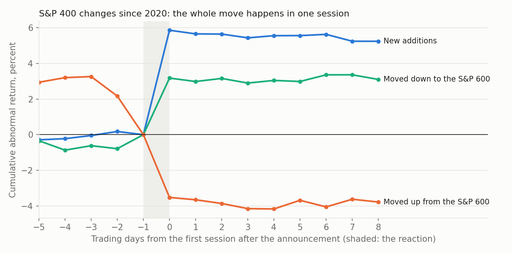

# What happens when a stock enters or leaves the S&P 400, and can you trade it?

[](https://github.com/rxj0102/index-drift-alpha/actions/workflows/ci.yml)

**Question.** Index funds must buy a stock that joins their index and sell one that leaves, on a date announced in advance. That is the cleanest case of forced, predictable demand in equity markets. How big is the price effect in mid caps, which way does it go when a stock moves between two indices, and is any of it left for someone who trades on the public announcement?

<!-- headline:start (generated by scripts/render_readme.py, do not edit by hand) -->
**Answer, from 658 events between 2012 and 2026: the price moves a lot, and it moves before you can trade.** Since 2020 a stock newly added to the S&P 400 opens 6.6% higher than the market the morning after the announcement (t = 17.6, up in 97% of events). A stock demoted to the S&P 600 opens 3.4% higher, and a stock promoted from the S&P 600 opens 2.7% lower, so the sign follows index fund demand, not good or bad news. A stock moved down from the S&P 500 to the 400, where funds tracking the 500 sell what those tracking the 400 buy, barely moves (-0.4%, t = -1.7). After that open there is nothing: from the first close to the day the funds trade, on the effective day, and over the ten days after, none of the three has a significant return. Of 9 tradable tests one survives a multiple-testing correction, the first session of stocks promoted from the S&P 600 (-1.5%, corrected p = 0.04), and that group is the one whose announcement dates look least reliable.
<!-- headline:end -->

Every number on this page is written by `scripts/reproduce.py`, and CI reruns the study and fails if the page and the results disagree.



## Results

<!-- results:start (generated by scripts/render_readme.py, do not edit by hand) -->
930 additions and non-merger deletions from 2012-01-01 to 2026-09-30 (241 merger deletions are left out). 658 have prices (71%; 83% from 2020, 54% before). 456 also have a dated announcement; the median gap from the first session after it to the effective date is 5 trading days. Returns are relative to MDY. Cells show the mean across event dates with its t-statistic.

### Around the announcement, 2020 onward

| Group | Events | Ten days before | Overnight gap | First session, open to close | Then to the fund trade | Effective day and ten after |
|---|---|---|---|---|---|---|
| New additions | 110 | +0.33% (+0.4) | +6.64% (+17.6) | +0.28% (+0.8) | -0.53% (-1.0) | -0.59% (-0.6) |
| Moved up from the S&P 600 | 53 | -0.14% (-0.1) | -2.68% (-7.5) | -1.48% (-3.0) | -0.41% (-0.4) | +0.33% (+0.2) |
| Moved down to the S&P 600 | 128 | +0.03% (+0.0) | +3.40% (+10.2) | +0.76% (+1.7) | -0.48% (-1.3) | -0.68% (-0.8) |
| Moved down from the S&P 500 | 22 | +2.53% (+1.1) | -0.37% (-1.7) | +0.05% (+0.1) | -1.42% (-1.7) | +0.96% (+0.9) |
| Moved up to the S&P 500 | 43 | +0.59% (+0.5) | +1.10% (+2.9) | -0.33% (-0.6) | +0.57% (+0.7) | +0.33% (+0.2) |
| Other deletions | 8 | +6.25% (+1.3) | -3.77% (-2.9) | -8.77% (-3.6) | +7.33% (+2.4) | +1.44% (+0.1) |

The overnight gap is the close before the announcement to the next open. Nobody who learns of the change from the announcement can trade at the earlier close, so only the last three columns are tradable.

### The tradable windows, with a correction for nine tests

| Group | Window | Mean | t | p | p, Holm | Median event | Share positive |
|---|---|---|---|---|---|---|---|
| New additions | First session, open to close | +0.28% | +0.79 | 0.431 | 1.00 | -0.21% | 43% |
| New additions | First close to the fund trade | -0.53% | -1.05 | 0.298 | 1.00 | -0.15% | 48% |
| New additions | Effective day and ten after | -0.59% | -0.63 | 0.533 | 1.00 | -0.64% | 47% |
| Moved up from the S&P 600 | First session, open to close | -1.48% | -3.04 | 0.005 | 0.04 | -1.01% | 30% |
| Moved up from the S&P 600 | First close to the fund trade | -0.41% | -0.44 | 0.664 | 1.00 | -1.82% | 30% |
| Moved up from the S&P 600 | Effective day and ten after | +0.33% | +0.25 | 0.807 | 1.00 | +1.24% | 58% |
| Moved down to the S&P 600 | First session, open to close | +0.76% | +1.71 | 0.092 | 0.73 | +0.63% | 57% |
| Moved down to the S&P 600 | First close to the fund trade | -0.48% | -1.33 | 0.188 | 1.00 | -0.34% | 46% |
| Moved down to the S&P 600 | Effective day and ten after | -0.68% | -0.79 | 0.431 | 1.00 | -0.98% | 41% |

### A check on the dates

Abnormal return in the last session before the one counted as the first reaction. It should be zero if the announcement dates are right and nothing leaked.

| Group | Session before | t |
|---|---|---|
| New additions | -0.50% | -1.39 |
| Moved up from the S&P 600 | -2.08% | -4.95 |
| Moved down to the S&P 600 | +0.69% | +2.11 |

### Around the effective date, all events with prices

Day 0 is the effective date; index funds trade at the close of day -1.

| Group | Events with prices | Days -20 to -6 | Days -5 to -1 | Day 0 | Days +1 to +10 |
|---|---|---|---|---|---|
| New additions | 149 of 182 | +0.91% (+1.0) | +4.97% (+7.3) | -0.38% (-1.5) | +0.44% (+0.5) |
| Moved up from the S&P 600 | 80 of 92 | +5.83% (+2.9) | -5.33% (-5.1) | +0.56% (+1.1) | +0.53% (+0.4) |
| Moved down to the S&P 600 | 134 of 159 | -1.16% (-0.8) | +4.03% (+4.8) | +0.24% (+0.9) | +0.80% (+0.6) |
| Moved down from the S&P 500 | 22 of 29 | +2.21% (+1.4) | -2.07% (-5.2) | +0.54% (+1.2) | +0.41% (+0.3) |
| Moved up to the S&P 500 | 50 of 54 | +2.78% (+2.1) | +1.04% (+1.3) | +0.53% (+1.4) | -0.46% (-0.4) |
| Other deletions | 8 of 16 | -2.64% (-0.3) | +2.40% (+0.6) | +0.44% (+0.2) | +0.99% (+0.1) |
| All additions, 2012 to 2019 | 158 of 282 | +0.71% (+1.4) | +0.56% (+1.2) | +0.11% (+0.6) | -0.19% (-0.4) |
| All deletions, 2012 to 2019 | 57 of 116 | +0.76% (+0.5) | -2.85% (-3.2) | -0.22% (-0.7) | +0.75% (+0.6) |

Days -5 to -1 contain the announcement reaction for most events, which is why that column is large. Before 2020 origin and destination cannot be told apart, so opposite flows are pooled and the rows are weaker.
<!-- results:end -->

## Reading the results

- **The effect is demand, not information.** A promotion from the S&P 600 to the S&P 400 is good news about the company, and the stock falls. A demotion to the S&P 600 is bad news, and the stock rises. That is what you would expect if small cap index funds hold a larger share of a small stock than mid cap funds hold of a mid cap, so the small cap side of the move dominates. This study does not measure fund ownership, so that reading is a hypothesis that fits the signs.
- **The market prices it in one step.** The gap is there at the first open. Index funds do not trade until days later, at the close before the effective date, and nothing happens in between or afterwards. There is no drift to ride and no reversal to fade.
- **The one significant tradable cell should not be trusted.** Stocks promoted from the S&P 600 keep falling during the first session. But the same group already falls two percent in the session before. New additions do not move that day, and stocks moved down move well under one percent. Either some announcement dates in the source are a day late for these events, or the news got out early. Daily data cannot separate the two, and both make the first session a poor test.
- **Thirty event dates is not many.** That cell rests on the 53 events in the first table, spread over 30 dates. The corrected p-value is just under 0.05.
- **Costs are small next to the gap and large next to what is left.** A round trip in a mid cap costs some tens of basis points once impact is counted. That is nothing against a gap of several percent that you cannot get, and a real fraction of the tradable means, most of which are under half a percent.

## Design

| Choice | What and why |
|---|---|
| Events | S&P 400 additions and deletions from 2012, from the change table of the Wikipedia article, with the announcement date taken from each row's cited S&P press release. Merger deletions are excluded. |
| Groups | From 2020, by origin or destination: new to the index, down from the S&P 500, up from the S&P 600, down to the S&P 600, up to the S&P 500. S&P 500 membership spells come from the MIT-licensed history at github.com/fja05680/sp500. Before 2020 the S&P 600 change table does not exist, so events are pooled. |
| Abnormal return | Stock minus MDY, the S&P MidCap 400 ETF, same day. No beta adjustment. |
| Timing | S&P announces after the close. The first session after the announcement date is split into its overnight gap and its open to close return. |
| Inference | Events on the same date are averaged first, then a t-test runs across dates. Holm correction across the nine tradable tests. |
| Data | Yahoo Finance daily open and close, adjusted. Only the window around each event is stored in the repo. |

The windows and the nine tradable tests were written down before any abnormal return was computed for this version. An earlier version of the study, with close to close windows only, had already shown that the reaction sits near the announcement, so the choice to split that day was made knowing where the effect was.

## What was wrong with the first version

The repo began as a strategy that traded price drift in index weights: buy stocks whose weight had fallen below target, on the theory that index funds must rebalance toward them. Three things were wrong.

1. **The premise fails on algebra.** In a float-adjusted, cap-weighted index a fund that holds the right number of shares still holds the right number after any price move. Price changes create no rebalancing trades. The signal was just a stock's return relative to the index, which is short-term reversal under another name.
2. **The universe looked ahead.** A 2023 list of 50 members was applied back to 2015.
3. **The reference data was wrong.** Several float figures exceeded the companies' total shares outstanding in SEC filings.

A later check of the code found a fourth problem, in the classification. S&P 500 membership was read from the current member list, which cannot see a stock that has since left. So 29 stocks moved down from the S&P 500 to the 400 since 2020 were counted as new additions, although funds tracking the 500 sell them while those tracking the 400 buy. They are now their own group. Removing them raised the new additions' overnight gap from 5.8% (t = 13.9) to 6.6% (t = 17.6).

Passive flows come from index changes, share issuance and buybacks. This repo now studies the first of those, where the date and direction of the trade are public.

## Limits

- **Survivors.** About 30% of events have no prices, mostly firms that were later acquired, delisted or renamed, and coverage is worse before 2020. Results describe firms that still trade under the same ticker.
- **Ticker reuse.** A delisted firm's ticker can later belong to another company, and Yahoo would return the wrong history. Medians and the share of positive events are reported for that reason.
- **Announcement dates** come from citations on a Wikipedia page, not from S&P directly. The date check above suggests some are off by a day.
- **Daily bars.** The open is the first print, not a price at which size trades. A real attempt to trade the first session needs auction and intraday data.
- **Market adjusted returns** with a mid cap ETF. Small caps moving up have betas that differ from MDY.

## Reproduce

```bash
pip install -r requirements.txt
python -m pytest -q               # tests
python scripts/reproduce.py       # a few seconds, rewrites results/
python scripts/render_readme.py   # rewrites this page; --check compares only
```

Returns around each event are frozen in `data/snapshot/event_returns.csv.gz`. `python scripts/fetch_data.py` downloads prices again (needs `pip install yfinance`). The change tables in `data/reference/` were saved from Wikipedia on 2026-11-10 (CC BY-SA 4.0); `sp500_ticker_start_end.csv` is from github.com/fja05680/sp500 (MIT License), with its commit in the first line.

## Layout

```
src/events.py            the event list and its classification
src/study.py             windows, abnormal returns, date-clustered tests, Holm
scripts/                 fetch_data.py, reproduce.py, render_readme.py, compare_metrics.py
data/reference/          S&P 400 and 600 change tables, S&P 500 membership spells
data/snapshot/           daily returns around each event
tests/                   classification, window and inference checks
```

## References

- Greenwood, R. and Sammon, M. (2025). The disappearing index effect. *Journal of Finance*.
- Harris, L. and Gurel, E. (1986). Price and volume effects associated with changes in the S&P 500 list. *Journal of Finance* 41(4).
- Shleifer, A. (1986). Do demand curves for stocks slope down? *Journal of Finance* 41(3).
